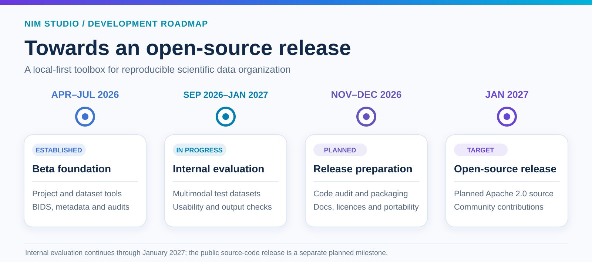

  

  <a href="https://nim-studio.readthedocs.io/"><strong>Documentation</strong></a> ·
  <a href="https://doi.org/10.5281/zenodo.21296291"><strong>Zenodo DOI</strong></a> ·
  <a href="https://research-software-directory.org/software/nim-studio"><strong>Research Software Directory</strong></a> ·
  <a href="https://bio.tools/nim-studio"><strong>bio.tools</strong></a>

---

## Overview

**NIM Studio — Neuro Informatics Management Studio** is a local-first desktop application for neuroinformatics and research data management, developed as an open-source research-software project. Its first public application source-code release is planned for January 2027.

It provides an integrated environment for:

`PROJECT STRUCTURE` · `BIDS` · `METADATA` · `DATA TRANSFORMATION` · `STORAGE AUDITING` · `DATA GOVERNANCE`

NIM Studio is designed to support FAIR- and GDPR-aware research data practices, BIDS-aligned data organization, directory and file administration, metadata preparation, structured data transformations, and research-storage review.

The beta release is centered on a simple principle:

> **Make research-data operations explicit, reviewable, and reproducible while keeping research data under the user's control.**

---

## Current release

| Release      | Status                        | Date         |
| ------------ | ----------------------------- | ------------ |
| `0.1.0-beta` | **Active evaluation release** | 16 June 2026 |

Version `0.1.0-beta` is under active development. Features, interfaces, workflows, file formats, and documentation may change before the first stable release.

The beta may contain incomplete functionality or defects. Users must review proposed operations and validate outputs before incorporating them into research or operational workflows.

The documentation and other original materials published in this repository are available under the [Apache License 2.0](./LICENSE), subject to the scope explained in [RIGHTS.md](./RIGHTS.md). The application source code is not yet public; its first open-source release is planned for **January 2027**. Prebuilt evaluation packages remain available to approved beta testers under separate [beta executable terms](./BETA_EXECUTABLE_LICENSE.md).

---

## Open-source roadmap

  

Internal evaluation continues through **January 2027**, alongside release preparation. The January 2027 source-code release is a **separate planned milestone**, subject to final testing and release-rights review. For ways to contribute now or propose scientific collaborations, see [Contributing & Collaboration](./CONTRIBUTING.md).

---

## Core modules

  

<table>
<tr>
<td width="50%" valign="top">

### Research Project Builder

Create configurable research-project structures for:

* administration
* governance
* source data
* analysis
* code
* workspaces
* derivatives

</td>

<td width="50%" valign="top">

### BIDS Dataset Builder

Initialize BIDS-oriented dataset structures including:

* participants
* sessions
* modality-specific directories
* source-data areas
* derivatives
* multimodal project layouts

</td>
</tr>

<tr>
<td width="50%" valign="top">

### BIDS Transformer

Inspect heterogeneous source datasets and prepare structured transformation plans including:

* subject identification
* session identification
* file classification
* routing
* renaming
* dry-run review
* transfer manifests

</td>

<td width="50%" valign="top">

### Metadata Builder

Prepare common study and dataset metadata including:

* `dataset_description.json`
* `participants.tsv`
* JSON sidecars
* dataset documentation
* reusable metadata templates

</td>
</tr>

<tr>
<td width="50%" valign="top">

### Duplicate Audit

Inspect research storage for:

* exact-content duplicates
* filename similarities
* version-like filename patterns
* candidate redundant files

Audit workflows are designed around **review before modification**.

</td>

<td width="50%" valign="top">

### Data-governance support

Support consistent:

* project organization
* dataset documentation
* storage review
* FAIR-oriented practices
* governance-aware data handling

</td>
</tr>
</table>

> Availability of individual functions may vary between beta builds. The documentation supplied with each build is the authoritative description of that release.

---

## Design principles

| Principle                       | Meaning                                                               |
| ------------------------------- | --------------------------------------------------------------------- |
| **Local-first processing**      | Research data remain locally controlled by default                    |
| **Data safety by default**      | Potentially destructive operations are review-oriented                |
| **Reproducible operations**     | Transformations should be traceable and repeatable                    |
| **Reviewable workflows**        | Proposed operations should be inspectable before execution            |
| **Scientific interoperability** | Designed around established research standards including BIDS         |
| **Transparent organization**    | Explicit project and dataset structures rather than opaque automation |
| **Sustainable data management** | Supports durable, maintainable research-data practices                |

NIM Studio is designed to operate locally unless a user explicitly enables a separately documented external integration.

Users remain responsible for verifying that their deployment and data handling comply with applicable institutional, contractual, ethical, and legal requirements.

---

## Intended use

NIM Studio is intended to support:

* neuroimaging research data organization
* neuroinformatics workflows
* dataset preparation
* metadata management
* research infrastructure administration
* storage review
* reproducible data-management operations

## Installation and beta access

This repository currently publishes open-licensed documentation and project resources. The NIM Studio application source code is scheduled for public release in **January 2027** and is not part of the current documentation repository.

Until then, approved beta participants receive prebuilt evaluation packages and installation instructions through a controlled distribution channel under the separate [beta executable licence](./BETA_EXECUTABLE_LICENSE.md).

Depending on the beta build, distribution may include:

`WINDOWS` · `macOS` · `LINUX` · `LINUX / HPC`

The current non-public evaluation packages must not be redistributed under their separate beta terms. The repository licence permits reuse of the open materials it covers.

Where checksums are supplied, verify both the application version and checksum before installation.

> [!WARNING]
> Do not install NIM Studio from unofficial sources or redistribute a beta package to another person.

---

## Documentation

The complete NIM Studio documentation is available at:

### [Read the NIM Studio documentation →](https://nim-studio.readthedocs.io/)

The documentation covers:

* installation and initial configuration
* Research Project Builder
* BIDS Dataset Builder
* BIDS Transformer
* Metadata Builder
* Duplicate Audit
* data-safety and governance considerations
* tutorials and synthetic examples
* known limitations
* troubleshooting
* release-specific changes

A persistent archival version is available through Zenodo:

**DOI:** [`10.5281/zenodo.21296291`](https://doi.org/10.5281/zenodo.21296291)

Public documentation describes the current beta workflows. Application source code is planned for release in January 2027; credentials, private endpoints, and confidential research materials remain excluded.

---

## Software registries

NIM Studio is indexed in research-software registries to support software discoverability, citation, and persistent reference.

| Registry                        | Record                                                                      |
| ------------------------------- | --------------------------------------------------------------------------- |
| **Research Software Directory** | [NIM Studio →](https://research-software-directory.org/software/nim-studio) |
| **bio.tools**                   | [NIM Studio →](https://bio.tools/nim-studio)                                |
| **Zenodo**                      | [Documentation record →](https://doi.org/10.5281/zenodo.21296291)           |

---

## Data protection and security

Users are responsible for determining whether they are authorized to process a dataset and for complying with applicable:

* data-protection legislation
* ethics approvals
* data-use agreements
* institutional policies
* security requirements
* retention requirements

Use synthetic or appropriately de-identified test data when evaluating a new workflow.

Never place participant data, credentials, access tokens, private keys, or confidential institutional information in public GitHub issues, documentation, or support requests.

> [!WARNING]
> Suspected vulnerabilities or data-security incidents must be reported privately through the official NIM Studio contact channel. Do not disclose vulnerability details in a public GitHub issue.

---

## Citation

If NIM Studio contributes to research or a scientific output, cite the **exact version used**.

### Software

> Monteiro, S. (2026). *NIM Studio: Neuro Informatics Management Studio* (Version 0.1.0-beta) [Computer software]. Beta evaluation release; public source-code release planned for January 2027. GitHub.

### Documentation

> Monteiro, S. (2026). *NIM Studio: Neuro Informatics Management Studio* (Version 0.1.0-beta) [Software documentation]. Zenodo. https://doi.org/10.5281/zenodo.21296291

Machine-readable citation metadata is provided in [`CITATION.cff`](./CITATION.cff).

When reporting use of NIM Studio, also record:

`SOFTWARE VERSION` · `OPERATING ENVIRONMENT` · `WORKFLOW CONFIGURATION` · `INPUT-DATA VERSION` · `MANUAL INTERVENTIONS`

These details help make software-supported workflows interpretable and reproducible.

---

## Rights and availability

**Copyright © 2026 Sara Monteiro.**

The original documentation and project materials published in this repository are licensed under the [Apache License 2.0](./LICENSE), except where [RIGHTS.md](./RIGHTS.md) identifies third-party materials or distinct visual-identity rights. The licence does not grant permission to imply endorsement or claim ownership of NIM Studio trademarks.

NIM Studio is an **open-source project in development**. The first public application source-code release is planned for **January 2027** under Apache 2.0, following final testing and rights review. The source code is not included in this repository at present.

Prebuilt evaluation packages currently distributed to beta participants remain subject to a separate [beta executable licence](./BETA_EXECUTABLE_LICENSE.md) and [beta policy](./BETA_POLICY.md). These distribution conditions do not restrict rights granted to the public repository materials under Apache 2.0.

See [Contributing & Collaboration](./CONTRIBUTING.md) for documentation contributions, feature proposals, and research collaboration opportunities.

---

## Third-party components

NIM Studio may include third-party components governed by their respective licences.

Applicable notices and licence texts are supplied with distributed application packages.

Third-party software, standards, names, and trademarks remain the property of their respective owners.

---

## Feedback and contact

We welcome public documentation corrections, feature proposals, and research collaboration enquiries through [Contributing & Collaboration](./CONTRIBUTING.md). Please keep all public issues free of sensitive research data.

Approved beta participants should continue to use the private feedback and support channel supplied during onboarding.

Questions concerning:

`BETA ACCESS` · `RESEARCH COLLABORATION` · `LICENSING` · `SECURITY`

should be directed to the official NIM Studio contact channel.

A public contact address will be added here once confirmed.

---

  

**NIM Studio**
*Neuro Informatics Management Studio*

`LOCAL-FIRST` · `BIDS-ALIGNED` · `REVIEWABLE` · `REPRODUCIBLE`

